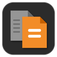
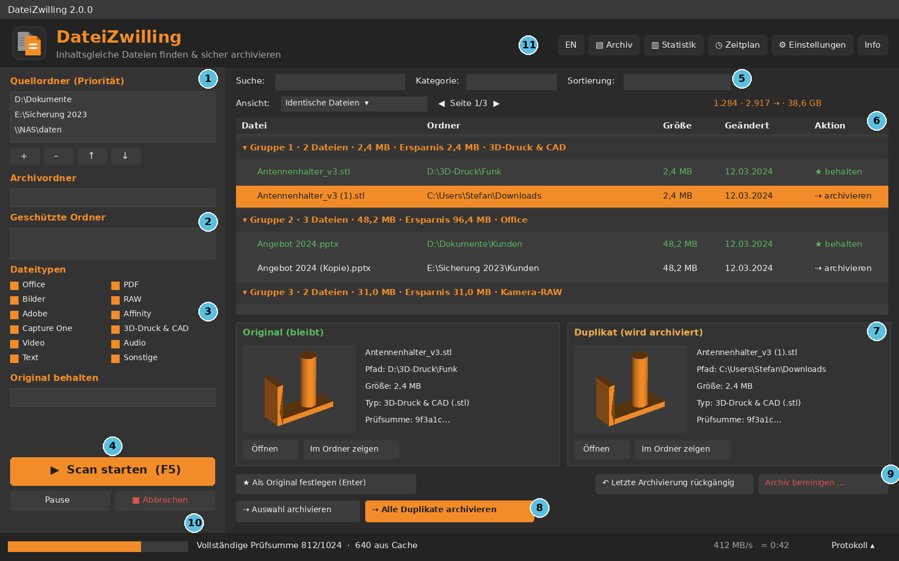

<p align="center">
  
</p>

<h1 align="center">DateiZwilling</h1>

<p align="center">
  <b>Identische Dateien finden – Duplikate sicher archivieren.</b><br>
  <i>Find identical files – archive duplicates safely.</i>
</p>

<p align="center">
  <a href="https://github.com/dm5cq/DateiZwilling/releases/latest"><b>⬇ Download (Windows-EXE)</b></a> ·
  <a href="Dokumentation/QuickGuide_DE.pdf">QuickGuide DE</a> ·
  <a href="Dokumentation/QuickGuide_EN.pdf">Quick Guide EN</a> ·
  <a href="CHANGELOG.md">Änderungen</a>
</p>

---

DateiZwilling durchsucht beliebig viele Ordner – lokal, USB, NAS, pCloud, OneDrive, Nextcloud – nach Dateien mit **identischem Inhalt**, egal wie sie heißen, und verschiebt die Duplikate in einen Archivordner, der die **Originalpfade exakt abbildet**. Gelöscht wird erst, wenn du das Archiv ausdrücklich freigibst.



## Funktionen

- **Alle Dateiformate** (Inhaltsvergleich): Word, Excel, PowerPoint, Access, Publisher, Visio, OneNote, LibreOffice, iWork, PDF, alle Bild- und RAW-Formate, Adobe, Affinity, Capture One, **3D-Druck & CAD** (STL, 3MF, OBJ, STEP, G-Code …), Video, Audio, Archive …
- **Zuverlässig:** Größe → Schnell-Prüfsumme → BLAKE2b-256 → Byte-für-Byte-Vergleich vor jedem Verschieben
- **Ausfallsicher:** Journal + Prüfsummen-Cache – nach Absturz, Stromausfall oder abgezogenem Laufwerk geht es an der Abbruchstelle weiter
- **Nichts geht verloren:** Verschieben statt Löschen, Rückgängig (auch einzelne Dateien), Bereinigen nur nach Freigabe und erneutem Vergleich mit dem Original
- Doppelte **Ordner**, **nahezu gleiche Dokumente**, Vorschau (Fotos, PDF, Office, RAW, STL in 3D), Archiv-Browser, Statistik, Zeitplan, Drag & Drop
- Deutsch / Englisch, hoher Kontrast, Schriftgröße, Sprachausgabe
- **Portable Windows-EXE** (keine Installation) und macOS-App

## Download und Start

1. Unter **[Releases](https://github.com/dm5cq/DateiZwilling/releases/latest)** `DateiZwilling.exe` herunterladen.
2. Optional die Prüfsumme kontrollieren: `certutil -hashfile DateiZwilling.exe SHA256` und mit `DateiZwilling.exe.sha256.txt` vergleichen.
3. Starten. Die EXE ist nicht signiert – Windows SmartScreen fragt beim ersten Start: **„Weitere Informationen“ → „Trotzdem ausführen“**.
4. Einstellungen, Cache und Protokolle landen im Ordner `DateiZwilling-Daten` neben der EXE (portabel, z. B. auf einem USB-Stick).

## Selbst bauen

| System | Befehl | Ergebnis |
|---|---|---|
| Windows | Doppelklick auf `build-exe.bat` | `dist\DateiZwilling.exe` + SHA-256-Datei |
| macOS | `./build-macos.sh` | `dist/DateiZwilling.app` + `.dmg` |
| direkt | `python DateiZwilling.py` | – |

Voraussetzung: Python 3.10+ von python.org (inkl. Tcl/Tk). Das Build-Skript legt eine virtuelle Umgebung an, installiert die Pakete aus `requirements.txt` und führt vorher die automatischen Tests aus (`python -m unittest discover -s tests`).

## Kommandozeile

```
DateiZwilling.exe --cli scan -s D:\Daten -s E:\Sicherung -a F:\DZ-Archiv --report bericht.html
DateiZwilling.exe --cli scan -s D:\Daten -a F:\DZ-Archiv --archive-now --yes
DateiZwilling.exe --cli resume | runs | undo --run 3 | purge --run 3
DateiZwilling.exe --cli import F:\DZ-Archiv
DateiZwilling.exe --cli restore --run 3 --file "D:\Daten\x.docx"
```

## Dokumentation

| Dokument | Inhalt |
|---|---|
| [QuickGuide_DE.pdf](Dokumentation/QuickGuide_DE.pdf) / [QuickGuide_EN.pdf](Dokumentation/QuickGuide_EN.pdf) | Bedienung in Kürze |
| [Technische_Beschreibung_DE.pdf](Dokumentation/Technische_Beschreibung_DE.pdf) / [Technical_Description_EN.pdf](Dokumentation/Technical_Description_EN.pdf) | Architektur, Verfahren, Ausfallsicherheit, Code-Review, Original-Prompt |
| [docs/CODE-REVIEW.md](docs/CODE-REVIEW.md) | Code-Review Sicherheit / Stabilität / Ausfallsicherheit |
| [docs/TESTPLAN.md](docs/TESTPLAN.md) | Testplan für den ersten Start |
| [docs/PROMPT.md](docs/PROMPT.md) | Original-Prompt und Anforderungen |

## English

DateiZwilling scans any number of folders for files with **identical content** – regardless of file name – and moves duplicates into an archive folder that **mirrors the original paths exactly**. Nothing is deleted until you explicitly release the archive. Download the portable Windows EXE from **[Releases](https://github.com/dm5cq/DateiZwilling/releases/latest)**; the interface is available in English (button **EN** in the header). See the [Quick Guide (EN)](Dokumentation/QuickGuide_EN.pdf) and the [Technical Description (EN)](Dokumentation/Technical_Description_EN.pdf).

## Lizenz und Haftungsausschluss / License and disclaimer

**Idee & Konzept:** Stefan J. Kaiser DM5CQ / OE8KKS · **Umsetzung:** Claude (Anthropic) · **Lizenz:** [GNU GPL v3](LICENSE)

Die Nutzung erfolgt auf eigene Gefahr. Die Software wird ohne jegliche Gewährleistung bereitgestellt (GNU GPL v3, Abschnitte 15 und 16). Soweit gesetzlich zulässig, haftet der Autor nicht für Datenverlust, Datenbeschädigung oder sonstige Schäden, die aus der Nutzung entstehen. Vor dem Bereinigen des Archivs wird eine aktuelle Datensicherung dringend empfohlen.

*You use this software at your own risk. It is provided without any warranty (GNU GPL v3, sections 15 and 16). To the extent permitted by law, the author is not liable for data loss or any other damage.*
